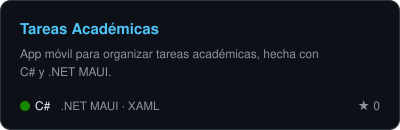
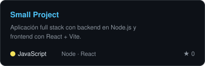
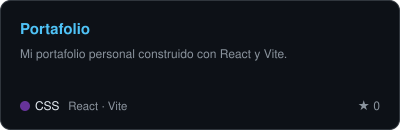
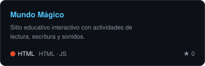
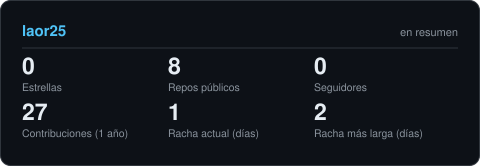
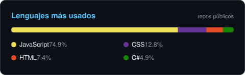

---

<!-- BANNER - terminal profile.sh --live. Generado por scripts/banner.py -->
<picture>
  <source media="(prefers-color-scheme: dark)"  srcset="assets/banner-dark.svg">
  <source media="(prefers-color-scheme: light)" srcset="assets/banner-light.svg">
  
</picture>

 

<!-- NOMBRE / TAGLINE - texto animado -->

 

<!-- CONTACTO -->
&nbsp;&nbsp;
&nbsp;&nbsp;

 

---

## Este soy yo :)

Hola, soy **Luis**, desarrollador de software desde Guayaquil, Ecuador 🇪🇨.
Soy egresado de **Desarrollo de Software** en el Instituto Tecnológico Superior Liceo Cristiano
(título en proceso) y estoy listo para mi **primera oportunidad profesional**.

- 💻 Desarrollo **aplicaciones web y APIs REST** con **C# / ASP.NET (.NET 9 y 10)** y **Python / Django**.
- 🎨 En el frontend trabajo con **Angular, TypeScript y React**, además de HTML, CSS y JavaScript.
- 📱 Construyo apps móviles con **.NET MAUI**.
- 🗄️ Manejo bases de datos **SQL Server, MySQL y MongoDB**.
- 🌐 Configuro **redes virtuales y físicas** y máquinas virtuales en **VirtualBox** (Windows y Xubuntu).
- 🌱 **Autodidacta**: responsable, proactivo y siempre aprendiendo algo nuevo.
- 🤝 **Abierto a oportunidades**: trabajo junior, prácticas o proyectos en equipo. ¡Escríbeme!
 

## mi stack`

---

## señales

<table>
<tr>
<td width="50%" align="center" valign="middle">

<!-- Radar de habilidades - edita assets/skills.json y el workflow lo redibuja -->
<picture>
  <source media="(prefers-color-scheme: dark)"  srcset="assets/radar-dark.svg">
  <source media="(prefers-color-scheme: light)" srcset="assets/radar-light.svg">
  
</picture>

</td>
<td width="50%" align="center" valign="middle">

<!-- Radar de lenguajes - edita assets/langmix.json -->
<picture>
  <source media="(prefers-color-scheme: dark)"  srcset="assets/radar-langs-dark.svg">
  <source media="(prefers-color-scheme: light)" srcset="assets/radar-langs-light.svg">
  
</picture>

</td>
</tr>
</table>

---

## proyectos

<!-- Tarjetas generadas por scripts/cards.py a partir de assets/projects.json -->
<a href="https://github.com/laor25/TareasAcademicas"><picture>
  <source media="(prefers-color-scheme: dark)"  srcset="assets/card-TareasAcademicas-dark.svg">
  <source media="(prefers-color-scheme: light)" srcset="assets/card-TareasAcademicas-light.svg">
  
</picture></a>
<a href="https://github.com/laor25/small_project"><picture>
  <source media="(prefers-color-scheme: dark)"  srcset="assets/card-small_project-dark.svg">
  <source media="(prefers-color-scheme: light)" srcset="assets/card-small_project-light.svg">
  
</picture></a>
 
<a href="https://github.com/laor25/Portafolio"><picture>
  <source media="(prefers-color-scheme: dark)"  srcset="assets/card-Portafolio-dark.svg">
  <source media="(prefers-color-scheme: light)" srcset="assets/card-Portafolio-light.svg">
  
</picture></a>
<a href="https://github.com/laor25/ofim-ticas"><picture>
  <source media="(prefers-color-scheme: dark)"  srcset="assets/card-ofim-ticas-dark.svg">
  <source media="(prefers-color-scheme: light)" srcset="assets/card-ofim-ticas-light.svg">
  
</picture></a>

---

## ¿los números importan? ohhh sí.

<!-- Generadas por scripts/cards.py en este mismo repo, sin depender de
     github-readme-stats ni otros servicios públicos que se caen. -->
<picture>
  <source media="(prefers-color-scheme: dark)"  srcset="assets/card-stats-dark.svg">
  <source media="(prefers-color-scheme: light)" srcset="assets/card-stats-light.svg">
  
</picture>

 

<picture>
  <source media="(prefers-color-scheme: dark)"  srcset="assets/card-langs-dark.svg">
  <source media="(prefers-color-scheme: light)" srcset="assets/card-langs-light.svg">
  
</picture>

---

` Hecho con dedicación · Luis Olvera · Guayaquil 🇪🇨 `

---
